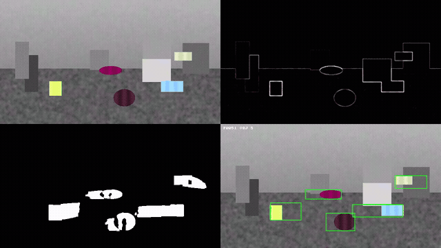

# Real-time motion detection on a Zynq-7000 (ZedBoard)

Live video from an IP camera is processed in the programmable logic of a
ZedBoard: Gaussian smoothing, Sobel edges, background subtraction, morphology
and connected-component labelling. Moving objects get bounding boxes drawn on
the image, which goes out over HDMI. Every RTL block is checked bit-exact
against an independent Python model.



## Architecture

```mermaid
flowchart LR
  CAM[IP camera<br/>RTSP H.264] --> PC[PC: ffmpeg decode<br/>640x360 YUYV]
  PC -- "UDP 92 Mbit/s" --> PS[Zynq PS<br/>bare-metal lwIP]
  PS -- DDR --> DMA[AXI DMA]
  subgraph PL [Programmable logic, 148.5 MHz]
    DMA --> L[luma] --> GA[Gauss 3x3] --> SO[Sobel] --> MO[motion<br/>EMA background<br/>in BRAM]
    MO --> ER[erode] --> D1[dilate] --> D2[dilate] --> CC[labelling<br/>+ boxes] --> OV[overlay<br/>boxes + text]
    OV --> DMA2[AXI DMA]
    VD[VDMA] --> UP[2x upscale] --> VO[AXI4-S to video]
  end
  DMA2 -- DDR --> VD
  VO -- "74.25 MHz, 720p60" --> HDMI[ADV7511 -> monitor]
  PS -- "UDP: boxes, timing" --> PC
```



| Block | What it does | RTL |
|---|---|---|
| luma | Y from YUYV (or BT.601 from RGB) | `rtl/luma.sv` |
| Gauss | 3x3 binomial, round half up, edge replication | `rtl/win3x3_filter.sv` |
| Sobel | L1 magnitude, run-time shift, saturation | `rtl/win3x3_filter.sv` |
| motion | background Q8.4 in BRAM, EMA update, threshold | `rtl/motion_detect.sv`, `rtl/bram_banked.sv` |
| morphology | erode, dilate, dilate (3x3, binary) | `rtl/win3x3_filter.sv` |
| labelling | single-pass 8-connected union-find, box + area per root, top-8 | `rtl/ccl_bbox.sv` |
| overlay | mode select, 2 px box outlines, 16-char text (8x8 font) | `rtl/overlay.sv` |
| control | AXI4-Lite registers, run-time thresholds and modes | `rtl/vproc_regs.sv` |
| display | 2x nearest upscaler, 4:2:2-correct chroma | `rtl/upscale2x.sv` |

One window generator (two line buffers, flush steps for the right and bottom
border) serves Gauss, Sobel, erode and dilate. Each stage carries the pixels
later stages need as side data, so there are no separate delay lines. Each
block ends in a skid buffer, so `tready` is registered at every boundary.

Register map, stream format and network protocol: [docs/SPEC.md](docs/SPEC.md).
Design decisions with the numbers behind them: [docs/DECISIONS.md](docs/DECISIONS.md).

## Verification

`python sim/run_sim.py` runs every block and the whole pipeline in Vivado
xsim and compares the output beat by beat (data, `tuser`, `tlast`) with the
golden model. Source gaps and sink back-pressure are random in most tests.

The model (`model/golden.py`) works on whole frames with NumPy padding and
SciPy labelling, so it shares no structure with the streaming RTL: it cannot
reproduce a line-buffer or label-merge bug.

| Test | Content |
|---|---|
| luma_yuyv, luma_rgb | random pixels, RGB extremes |
| gauss_rand, gauss_tiny, gauss_clip, gauss_noback | 37x23, 2x2, 3x2, full 640x360 frames, with and without back-pressure |
| sobel_rand, sobel_clip | all 4 shift settings, saturating edge |
| morph_rand | erode and dilate on blobs, 50 % noise, all-ones |
| motion | 6 frames, background re-initialised mid-sequence |
| ccl_rand, ccl_shapes, ccl_clip, ccl_overflow | blobs, U-shape, ring, spiral, zigzag (30 merges in one row), checkerboard, full frame, label overflow |
| overlay | all 6 modes, overlay on/off, boxes at the borders, text |
| upscale | 2x, chroma pairing |
| top_boxes, top_modes | whole pipeline through AXI-Lite and DMA-style streams, 640x360 |

Result: **18/18 bit-exact** (`sim/last_run.txt`). As a check on the checker,
two deliberate bugs (Gauss rounding +7 instead of +8; label union disabled)
were injected and both were caught.

On hardware, `host/sender.py --verify` sends a clip and compares the boxes the
board reports for every frame with the model.

## Results

### Implementation (XC7Z020-1, Vivado 2025.2, `hw/reports/`)

| | |
|---|---|
| Processing clock | 148.5 MHz (the 1080p60 pixel rate), display 74.25 MHz (720p60) |
| Setup / hold slack | WNS **+0.169 ns**, WHS +0.016 ns, 0 failing endpoints |
| Whole design | 13 090 LUT (24.6 %), 14 374 FF (13.5 %), 104 / 140 BRAM tiles, 0 DSP |
| Pipeline (vproc) | 5 728 LUT; background model 57 BRAM banks (230 400 x 12 bit) |
| Power (report_power) | 2.31 W on chip, of which the PS7 is the largest part |
| CDC | one data crossing (AXI4-Stream to video out FIFO); report_cdc: no critical/warning entries |

Timing closure took four implementation runs; each was driven by the
failing-path groups (`hw/timing_groups.tcl`), not by tool strategies:

| Run | WNS | Fix |
|---|---|---|
| 1 | -4.29 ns | Sobel/Gauss kernel was one combinational stage; labeller address muxed by `tuser` before a LUTRAM read |
| 2 | -1.84 ns | background RAM write data fanned out to 57 BRAMs; box-table BRAM output fed comparators directly |
| 3 | -0.76 ns | clock enable to ~114 BRAMs replaced by credit-based flow control; LUTRAM/BRAM write ports registered; overlay split into 3 stages |
| 4 | **+0.17 ns** | labeller decode cycle for foreground pixels; box merge precomputed; DMA length counter 23 -> 20 bit |

### Simulation (148.5 MHz model clock)

| Measure | Value |
|---|---|
| Frame latency, first input pixel to last output pixel, 640x360 | 257 636 cycles = **1.73 ms** |
| Cycles per pixel | 1.12 (window blocks 1 px/clk; the labeller adds cycles per foreground pixel) |
| Headroom at 25 fps | 40 ms frame period vs 1.73 ms processing |

### On the board

<!-- HW_RESULTS -->

## Build

Requirements: Vivado/Vitis 2025.2, Python 3 with NumPy, SciPy, Pillow; ffmpeg.

```
python tools/gen_clips.py                     # synthetic test clips (or tools/capture_clips.py)
python sim/run_sim.py                         # all simulations
vivado -mode batch -source hw/build.tcl       # bitstream, reports, .xsa
vitis -s sw/vitis_build.py                    # platform + firmware
python sw/make_boot.py                        # sw/boot/BOOT.BIN for the SD card
```

Run: copy `BOOT.BIN` to a FAT32 SD card, set the ZedBoard boot jumpers to SD,
connect Ethernet (PC 192.168.1.x, board 192.168.1.10) and HDMI, then

```
python host/sender.py --rtsp --seconds 60 --log run.csv      # camera, URL in .env
python host/sender.py --clip clips/syn_busy.yuv --verify     # check against the model
python host/ctl.py mode 3                                    # sobel view, see ctl.py
```

## Layout

```
model/   golden model, font            rtl/   SystemVerilog
tb/      testbench                     sim/   test runner and comparator
hw/      block design, XDC, reports    sw/    firmware, Vitis and boot scripts
host/    PC sender, control, emulator  tools/ clips, memory init
docs/    spec, decisions, media
```

## Credits

Design, architecture decisions and hardware bring-up: Batuhan Özkaner.
An AI assistant (Claude) helped write test scaffolding, scripts and parts of
the documentation. 8x8 font: font8x8_basic by Daniel Hepper (public domain).
